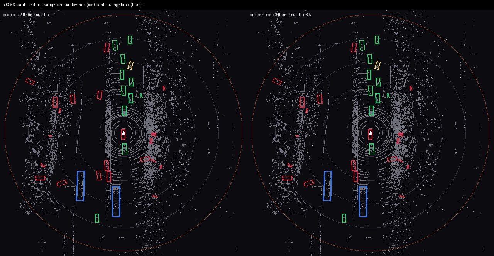

# Báo cáo Day 14 — Nguyễn Trọng Bình — 2A202603099

> Sao chép file này thành `report/individual/<MSSV>_<HoTen>.md` (không dấu), ví dụ `2A20260000_NguyenVanAn.md`.

- Mã học viên dùng với `--student`: `099`
- `seed_tag` trong `frames_A.txt`: `393590736f`

## 1. Dự đoán trước sweep (bước 5b)

Ghi **trước** khi chạy `scripts/pp_sweep.py`, rồi commit và push ngay (lịch sử commit là bằng chứng thời điểm viết). Không sửa phần này sau khi có kết quả.

- Tham số tôi nghĩ giảm công sửa nhiều nhất: Tăng `score_thr` lên mức vừa phải (khoảng `0.3` đến `0.4`) kết hợp đặt `min_points = 5`.
- Vì sao (nhìn ảnh BEV tập A: box thừa nhiều hay box sót nhiều?): Trên 3 frame tập A (`s03f56`, `s04f02`, `s05f27`), mô hình dự đoán tới 88 box trong khi nhãn chuẩn chỉ có 57 box — lượng **box thừa rất nhiều** (phải xóa 39 box, tốn $39 \times 0.3 = 11.7$ điểm chi phí, chiếm hơn một nửa tổng chi phí `20.2`; riêng frame `s03f56` dư 22 box, phần lớn là `Cyclist` và `Car` nhận nhầm vào bụi cây, cột điện hoặc nhiễu nền ít điểm LiDAR). Ngược lại, số box sót chỉ có 8 box ($8 \times 1.0 = 8.0$ điểm). Vì vậy, nâng `score_thr` lên `0.3`–`0.4` và lọc bỏ các box có dưới `5` điểm LiDAR sẽ cắt giảm mạnh các box nhiễu để hạ chi phí xóa, đồng thời tránh đặt ngưỡng quá gắt (như `0.5`) gây lọc nhầm xe thật ở xa (mỗi box sót bị phạt `1.0`, đắt gấp hơn 3 lần xóa).

## 2. Tập A: sửa tay và tune

| Cấu hình | Xóa | Thêm | Sửa | Chi phí |
|---|---:|---:|---:|---:|
| Gốc | 39 | 8 | 1 | 20.2 |
| `best_config.json` | 37 | 8 | 1 | 19.6 |

- Tham số đã đổi trong `best_config.json`: `min_points: 0 -> 5` (giữ nguyên `score_thr = 0.1`).
- Kết quả leave-one-out (dán các dòng `scripts/pp_sweep.py` in ra):
  ```text
  s03f56: cấu hình chọn {'score_thr': '0.1', 'min_points': '5'} → 8.5 (tốt nhất có thể 7.9)
  s04f02: cấu hình chọn {'score_thr': '0.1', 'min_points': '5'} → 5.8 (tốt nhất có thể 4.9)
  s05f27: cấu hình chọn {'score_thr': '0.4', 'min_points': '0'} → 6.7 (tốt nhất có thể 5.3)


## 3. Trước/sau (bước 8)



- `scripts/pp_compare.py` báo giảm `3%` công sửa trên tập A (`20.2` xuống `19.6`).
- Dự đoán ở mục 1 đúng hay sai? Giải thích bằng số box xóa/thêm/sửa: Dự đoán ở mục 1 **đúng một nửa**. Việc đặt `min_points = 5` đúng như dự đoán khi loại bỏ được 2 box nhiễu ít điểm (`xóa` giảm từ `39` xuống `37`) mà không làm tăng box sót (`thêm` giữ nguyên `8`, `sửa` giữ nguyên `1`), giúp tổng chi phí giảm từ `20.2` xuống `19.6`. Ngược lại, dự đoán tăng `score_thr` lên `0.3`–`0.4` chưa tối ưu hơn mặc định `0.1`: ở mức `score_thr = 0.4`, số box `xóa` giảm mạnh từ `39` xuống `22` (tiết kiệm $17 \times 0.3 = 5.1$ điểm), nhưng số box `thêm` lại tăng từ `8` lên `13` (tốn thêm $5 \times 1.0 = 5.0$ điểm phạt vẽ mới), khiến tổng chi phí cũng chỉ đạt `19.6` trong khi rủi ro bỏ sót đối tượng thật cao hơn.

## 4. Tập B

Số đo từ `scripts/pp_prelabel.py --frames d14_099/frames_B.txt --config d14_099/best_config.json --gt d14_099/ref_B.json`:

| Xóa | Thêm | Sửa | Chi phí |
|---:|---:|---:|---:|
| 228 | 17 | 17 | 93.9 |

- Loại box tốn công sửa nhất ở tập B:
  - **Xét theo tổng điểm chi phí công thức:** Box thừa (`xóa 228` box, tốn $228 \times 0.3 = 68.4$ điểm, chiếm `72.8%` tổng chi phí `93.9`) chiếm tỷ trọng lớn nhất. Do `best_config.json` giữ `score_thr = 0.1`, mô hình dự đoán tới `366` box cho `155` đối tượng thật, đặc biệt là nhiều box `Cyclist` giả (như `s01f30` có 17 `Cyclist`, `s01f51` có 13 `Cyclist`) và `Car` bắt nhầm vào bụi cây, dải phân cách.
  - **Xét theo công thao tác thủ công trên CVAT:** Các box bị sót phải vẽ mới (`thêm 17` box, trọng số `1.0`/box = `17.0` điểm, tập trung ở `s03f23` và `s05f43` với 5 box sót mỗi frame — chủ yếu là `Truck`/`Bus` mà model KITTI chưa được học hoặc xe bị che khuất một phần) cùng các box lệch kích thước/góc quay phải căn chỉnh lại (`sửa 17` box = `8.5` điểm, điển hình là các box có cảnh báo kích thước ở `s01f30`, `s01f51`, `s02f22`, `s02f40`).

## 5. Giới hạn

- **Tập tune A nhỏ (chỉ 3 frame) nên dễ bị quá khớp theo từng cảnh:** Kết quả leave-one-out trên `s05f27` khác hẳn 2 frame còn lại, đồng thời cỡ mẫu nhỏ khiến sweep ưu tiên giữ `score_thr = 0.1` để tránh phạt nặng lỗi `thêm`, nhưng khi áp dụng sang 12 frame tập B lại phát sinh tới `228` box thừa.
- **Lệch miền dữ liệu và thiếu lớp đối tượng giữa KITTI và VF:** Mô hình PointPillars tiền huấn luyện trên KITTI chỉ nhận diện 3 lớp (`Car`, `Cyclist`, `Pedestrian`) với góc nhìn phía trước; khi chạy 4 lượt xoay trên LiDAR 360° của VF, mô hình bỏ sót hoàn toàn `Truck` và `Bus` (phải vẽ tay bổ sung) và dễ nhận nhầm điểm nền thành `Cyclist`.
- **Công thức chi phí chưa phản ánh sát thời gian thao tác thực tế:** Công thức `0.3·xóa + 1.0·thêm + 0.5·sửa` dùng trọng số tuyến tính cố định, trong khi thực tế trên CVAT 3D việc vẽ mới một cuboid ở xa/thưa điểm hoặc chỉnh góc yaw và kích thước L/W/H trên cả 3 khung nhìn (Top/Side/Front) tốn nhiều thời gian hơn so với thao tác xóa các box nhiễu nằm rời rạc.